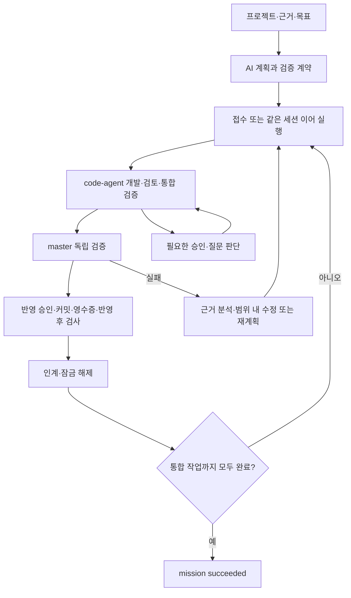

# master-agent

여러 프로젝트의 code-agent를 연결해 목표를 분석하고, 작업을 배정·검증·인계하는 CLI 오케스트레이터입니다. `master-agent` 명령으로 실행하고 `master-agent dashboard`로 등록 프로젝트 전체를 감시합니다. LangGraph JS가 실행 흐름을 제어하고 SQLite에 판단·증거·체크포인트를 저장합니다.

현재 대시보드에서 프로젝트 등록·삭제·서비스 그룹 관리·TASK 번호를 포함한 그룹/단일 요청·code-agent 일괄 업데이트, **공통 질문·승인 요청함과 단계별 타임라인**을 제공합니다. 실제 Claude로 두 프로젝트의 병렬 개발·계약 인계·통합 완료를 검증했으며, 최신 자동 회귀와 브라우저 시험의 결과·범위는 [검증 기록](docs/verification.md)에 정리했습니다.

## 실행 프로세스

| 단계 | master-agent | code-agent |
| --- | --- | --- |
| 1. 프로젝트 준비 | 프로젝트·도메인·정책 근거 등록, 제어자 연결 | 설정·검증 명령·계약 문서 출력 위치 준비, 사용자가 연동과 위임 권한 부여 |
| 2. 목표·계획 | 목표·완료 조건·허용 범위를 받아 AI 계획 생성 및 근거·의존성 검사 | 기존 작업·상태·소유권 제공 |
| 3. 검증 계약 | 허용 파일·독립 검사·산출물·반영 조건 및 함수·입력·오류 계약(`exports`) 등록 또는 템플릿 연결 | 프로젝트 자체 검사 설정 유지 |
| 4. 개발 | 판단·잠금 저장 → 독립 프로젝트 접수 → 실행별 결과 조회·같은 세션 이어 실행 | 요구 확정 → 분석 → 영향 조사 → 설계 → 계획·검토 → 구현 → 테스트 → 리뷰 → 깨끗한 작업 트리 통합 검증 |
| 5. 판단·반영 | 권한 범위의 routine 승인·답변, 반영 전 독립 검사, 반영 커밋·영수증과 반영 후 검사 대조 | 권한·동의 내용·상태를 검증하고 승인 적용 및 로컬 반영 |
| 6. 인계·통합 완료 | 소스·계약 문서·검사·커밋 대조 → 잠금 해제·`inputContracts` 전달 → 통합 조건 대조 후 `succeeded` | 후속 작업의 첫 담당 배정 전에 `planning contracts`로 근거 등록 → 담당 입력·입력 해시에 연결 |



- **판단:** routine만 부여된 권한 안에서 처리합니다. ambiguous는 재검토 또는 추가 정보 요청, critical은 사람 판단으로 넘깁니다. 판단과 근거를 적용 전에 저장합니다.
- **완료:** 모델의 완료 메시지나 호스트 종료만으로 성공 처리하지 않습니다. 파일 범위·검사 결과·현재 트리·반영 계약을 대조합니다. 로컬 완료가 원격 push·배포 완료를 뜻하지는 않습니다.
- **실패·중단:** 확인된 실패는 범위 내 복구·재계획으로 연결합니다. 실행 여부가 불명확하면 `unknown`으로 보존하고 중복 제출하지 않습니다. 재시작 시 같은 실행에 재부착합니다.
- **실행 순서:** `drive --control`은 독립 프로젝트를 먼저 접수하고 실행 결과를 차례로 조회합니다. 외부 개발 실행은 겹칠 수 있고, 도메인 기록·판단·검사는 순차 처리합니다. 동일 프로젝트 잠금과 선행 작업 인계 조건은 유지합니다. 직접 Claude 실행과 개별 `dispatch/continue/reattach` 명령은 종료를 기다립니다.
- **진행 표시:** 저장된 `state`는 기존 제어 규칙을 유지합니다. `mission progress` 또는 `mission show`의 `progress`에서 실행 중, 승인 처리 대기·처리 중, 사람 답 필요, 실제 장애를 구분합니다.
- **계약 등록:** `exports[].documentPath`가 있으면 커밋된 문서의 원문·해시를 code-agent가 다시 검증해 세부 담당에게 전달합니다. 해당 문서는 작업 범위와 code-agent의 단계 출력 위치에 미리 포함해야 합니다. 계약 등록 명령을 지원하는 code-agent 빌드가 필요합니다.

## 설치와 빠른 확인

Node.js **24.19 이상 24.x**와 Git이 필요합니다. 실제 개발에는 빌드된 code-agent와 요청에서 고른 host의 CLI(Claude, Codex 또는 둘 다)가 필요합니다. 고른 host가 code-agent 개발과 master 계획·판단을 함께 맡습니다. 실제 모델 전체 흐름 검증은 Claude로 수행했습니다.

소스 저장소에서 의존성을 준비한 뒤 로컬 패키지를 전역 명령으로 등록합니다. 현재 공개 npm 배포는 제공하지 않습니다.

```powershell
cd C:\IdeaProjects\master-agent
npm.cmd ci --ignore-scripts
npm.cmd install -g --ignore-scripts "C:\IdeaProjects\master-agent"
master-agent help
```

개발 중에는 전역 설치 대신 저장소에서 `npm.cmd link --ignore-scripts`로 연결할 수 있습니다. Windows 실행 정책이 `.ps1` 실행을 막으면 `master-agent.cmd`를 사용합니다. 명령을 찾지 못하면 npm 전역 설치 경로(`npm.cmd prefix -g`)가 PATH에 있는지 확인합니다.

**데이터 위치는 명령을 실행한 디렉터리 기준** `.master-agent/master.db`입니다. 여러 터미널에서 같은 현황을 보려면 같은 작업 디렉터리에서 실행하거나 동일한 절대 `--db` 경로를 지정합니다. 설치 폴더를 작업 디렉터리로 사용할 필요는 없습니다.

```powershell
# 별도 작업 디렉터리에서 설치 확인용 모의 실행
master-agent demo --db .master-agent/demo.db
master-agent mission list --db .master-agent/demo.db
```

데모는 세 프로젝트의 고정 계획을 모의 실행하고 `simulation-complete`로 끝납니다. 실제 프로젝트 개발 완료와 구분합니다. 소스 검증은 저장소에서 `npm.cmd test`, `npm.cmd run check`로 수행합니다. 소스 변경은 연결된 명령에 반영됩니다. master-agent 전용 `init`·`doctor`·`update`와 단일 실행 파일 배포는 아직 없으며, 제거는 `npm.cmd uninstall -g master-agent`로 합니다. 대상 프로젝트의 code-agent 설치·초기화는 별도로 수행합니다.

## 전체 현황 대시보드

```powershell
master-agent dashboard --db C:\workspace\control\master.db

# 다른 터미널에서 같은 DB의 서버 확인·재시작·종료
master-agent dashboard status --db C:\workspace\control\master.db
master-agent dashboard restart --db C:\workspace\control\master.db
master-agent dashboard stop --db C:\workspace\control\master.db
```

출력된 `http://127.0.0.1:4310`을 브라우저에서 엽니다. **설치된 code-agent는 자동 탐색**합니다. PATH의 실행 파일·npm 전역 설치와 링크를 확인하며 Windows npm 설치 경로도 확인합니다. 별도 빌드를 사용할 때만 `CODE_AGENT_CLI` 또는 `--cli`를 지정합니다. `--port <번호>`로 포트를 바꾸고, Ctrl+C로 대시보드 서버를 종료합니다. `--refresh-ms 5000`은 전체 조회가 끝난 뒤 다음 조회까지의 간격입니다.

`restart`는 기존 서버를 종료하고 **같은 DB·포트·조회 설정**으로 새 프로세스에서 실행합니다. 서버가 꺼져 있어도 마지막 설정으로 시작합니다. 시작·재시작 명령을 실행한 터미널은 유지해야 하며 자동 시작 서비스는 제공하지 않습니다. 코드 변경 후 `restart`를 실행하고 화면을 새로고침하세요. [연결 오류 해결](docs/ui.md#실행과-연결)에 상태 확인과 복구 방법이 있습니다.

- 같은 DB에 등록된 **모든 프로젝트**를 조회합니다. master 목표에 연결되지 않은 독립 code-agent 작업도 포함합니다. 등록 창에서는 알려진 작업 위치의 code-agent 설치 프로젝트를 찾아 선택할 수 있습니다.
- 등록 창을 열어 둔 동안 설치 프로젝트 목록을 자동 갱신합니다. 서버 실행 후 새 프로젝트에 code-agent를 설치해도 다음 조회에 감지하며 입력 중인 내용은 유지합니다. 후보 선택·등록 후 프로젝트 상태 관제도 자동으로 포함됩니다.
- 프로젝트별 상위/세부 단계·담당 작업, 브랜치·실행 시도·계획 실행 내역·검증 결과·리뷰 회수를 표시합니다. 승인·질문 대기와 목표별 진행 상태도 함께 확인할 수 있습니다.
- **단계별 타임라인**에서 프로젝트·그룹·TASK/작업/실행 ID로 이력을 검색하고 이전 기록을 조회합니다. 독립 실행 작업의 상태 변화도 누적 저장하며, 제어 연결이 있으면 code-agent 이벤트를 별도 커서로 이어 읽습니다. 재시작·반복 조회로 같은 기록을 중복 생성하지 않습니다. 질문·승인의 발행 상태 변화는 공통 요청함과 연결합니다.
- 설치된 code-agent의 `status --json`을 자동 조회합니다. 설치를 찾지 못하거나 `--saved`로 실행하면 저장된 관측과 master 기록을 표시합니다. 조회 실패·오래된 관측·이전 작업을 구분하고 프로세스 생존을 추정하지 않습니다.
- 프로젝트 수동 등록, 서비스 그룹 생성·구성원 편집, 그룹·단일 프로젝트 요청과 기존 요청 이어 실행을 화면에서 제공합니다. 질문·승인은 [공통 요청함](#공통-질문승인-요청함)에서 처리합니다. 질문과 무관한 실행 중지는 CLI를 사용합니다. code-agent 제어 토큰과 원본 모델 입력은 화면 API에 보내지 않습니다.
- 프로젝트 카드의 **프로젝트 삭제 → 등록 해제**로 관제·새 요청·업데이트 대상과 모든 그룹에서 제외합니다. 폴더·소스·code-agent·이전 실행 이력은 보존합니다. 미완료 master 목표, 실행·업데이트 잠금, 전송·적용이 미확인인 사람 응답이 있으면 먼저 해결해야 합니다. 같은 폴더를 다시 등록할 때는 새 프로젝트 ID를 사용합니다.
- **전체 프로젝트 업데이트 확인**의 기본 방식은 **원격 최신 버전 받아 적용**입니다. code-agent가 제공한 설치 문구·해시를 확인하면 `update --install-only`로 릴리스를 설치합니다. 설치 후에는 프로젝트별 적용 문구·해시를 다시 확인하고, 반환된 릴리스 ID로 적용한 뒤 `version --json`으로 일치를 검사합니다. 설치만 마친 상태에서는 프로젝트를 바꾸지 않습니다. 작업·승인 진행 중인 프로젝트는 건너뛰며 **현재 설치본만 적용**도 제공합니다. 진행·오류·중단 규칙은 [일괄 업데이트](docs/ui.md#code-agent-일괄-업데이트)를 따릅니다.

현재 브랜치에 작업이 없어도 업데이트가 건너뛰어질 수 있습니다. 작업 관측은 `status --json`, 업데이트 가능 여부는 `version --json`의 `project.busy`를 따르며, code-agent는 후자에서 다른 브랜치의 미완료 작업도 검사합니다. 관측 규칙과 HTTP 계약은 [로컬 대시보드](docs/ui.md)를 참고하세요.

타임라인은 수집한 관측과 이벤트의 이력입니다. 상태 조회 사이에 지나간 단계나 code-agent에서 이미 삭제된 이벤트를 복원하지 않으며 누락 구간을 표시합니다. 단계별 산출물 전문·실시간 개발 로그 조회는 후속 범위입니다.

원격 업데이트에는 upstream이 설정된 code-agent Git 소스 설치가 필요하며, 로컬 미커밋 변경은 배포에 포함하지 않습니다. 전송·적용이 미확인인 사람 응답이 있는 프로젝트도 업데이트에서 제외합니다.

## 서비스 그룹과 유지보수 요청

대시보드에서 같은 서비스의 유지보수 범위를 그룹으로 묶습니다.

1. **그룹 만들기**에서 ID·이름·유지보수 범위만 입력하고 저장합니다. 소속 프로젝트 목록을 표시하지 않고 새 빈 그룹을 만듭니다.
2. 저장한 그룹의 **구성 편집**에서 등록 프로젝트를 선택하거나 **새 프로젝트 수동 등록**을 엽니다. 설치된 code-agent 프로젝트를 검색·선택하면 이름·경로가 채워지며 직접 입력도 가능합니다. 담당 업무를 입력하고 프로젝트 ID는 비워 두면 자동 생성합니다.
3. **그룹 저장** 시 신규 프로젝트와 구성을 함께 반영합니다. 경로 중복·입력 오류가 있으면 전체 변경을 취소하며, 입력 중 취소한 신규 프로젝트도 등록하지 않습니다. 이후 같은 화면에서 프로젝트를 추가·제외합니다.

그룹 카드의 **그룹 삭제**에서 대상을 확인한 뒤 삭제할 수 있습니다. 빈 그룹과 프로젝트가 있는 그룹 모두 삭제할 수 있으며, 소속 프로젝트 등록·폴더와 이미 접수한 요청·실행은 유지합니다. 삭제한 그룹은 새 요청 대상에서 제외하고, 같은 ID를 재사용하지 않습니다. CLI에서는 `master-agent group delete <그룹ID> --revision <현재그룹버전>`을 사용합니다.

폴더 경로는 대시보드가 실행 중인 PC를 기준으로 합니다. **그룹에 요청** 또는 **이 프로젝트에 요청**에서 선택 항목인 **작업 TASK 번호**, 요청 내용·완료 조건을 입력합니다. 실행기는 기본 근거를 수집하고 설치·제어 연결을 점검한 뒤 계획·개발을 시작합니다. 준비가 부족하면 공통 요청함에 필요한 조치와 **준비 다시 확인 · 기존 요청 재개**를 표시합니다. 빈 그룹은 프로젝트를 추가한 뒤 요청할 수 있습니다.

CLI에서도 같은 작업을 제공합니다. 아래 예시는 기본 DB를 사용합니다. 앞의 대시보드 예시처럼 별도 DB를 사용했다면 **각 명령에 같은 `--db C:\workspace\control\master.db`를 추가**해야 같은 프로젝트·그룹을 조회하고 변경할 수 있습니다. `order-api`와 `payment-api`는 미리 등록한 프로젝트 ID입니다.

```powershell
master-agent group create commerce "커머스 서비스" --description "주문·결제 유지보수"
master-agent group add commerce order-api --revision 1
master-agent group add commerce payment-api --revision 2
master-agent group remove commerce payment-api --revision 3
master-agent group show commerce

master-agent group request commerce "주문 취소 오류 수정" --task-number UZRF-392 --criterion "취소 회귀 테스트 통과"
master-agent project request order-api "주문 조회 오류 수정" --task-number UZRF-393 --criterion "조회 테스트 통과"
master-agent group request commerce "결제 재시도 정책 변경" --host both --main codex --criterion "재시도 회귀 테스트 통과"
master-agent request list
master-agent request show <요청ID>
master-agent request continue <요청ID> --revision <요청버전>
```

그룹 요청은 **접수 당시 소속 프로젝트·그룹 버전·서비스 범위**를 고정합니다. 이후 그룹에서 제외한 프로젝트도 이미 접수한 요청에서는 원래 범위를 유지합니다. 같은 프로젝트가 여러 요청에 포함되면 기존 프로젝트 잠금으로 중복 개발을 막습니다.

TASK 번호는 요청 기록·AI 계획·각 프로젝트의 개발 지시에 공통으로 전달하며 이어 실행에서도 유지합니다. 내부 작업 ID와 code-agent 실행 ID는 별도로 유지합니다. 번호는 영문·숫자로 시작하는 64자 이하의 영문·숫자·점·밑줄·하이픈으로 입력하고 생략할 수 있습니다.

요청 ID는 목표 ID와 같습니다. 요청은 별도 백그라운드 실행기에서 `AI 계획 → 검증 계약 연결 → code-agent 개발 → 독립 검증·인계`를 진행하며, 대시보드를 닫아도 계속됩니다. 재전송 중복 방지는 `--request-key`로 지정할 수 있습니다. 요청마다 **host**를 고릅니다(`--host claude|codex|both`, 대시보드의 `실행 host`). host 하나를 고르면 그 host가 code-agent 개발과 master 계획·판단을 혼자 맡고 교차 검증은 하지 않습니다. `both`는 `--main`으로 고른 주 host가 개발·계획·판단을 맡고, 다른 host가 code-agent의 계획·코드 리뷰와 master의 계획·복구·위임 판단을 교차 검증합니다. 교차 검토에서 반려된 계획·판단은 실행하지 않습니다. 계획·복구는 지적을 반영해 다시 만들고 그래도 반려되면 막히며, 위임 판단은 사람에게 넘깁니다. 검토 host를 실행하지 못하면 검토 없이 통과시키지 않고 오류로 남깁니다.

그룹 요청은 소속 프로젝트 모두에 같은 host를 적용합니다. 고른 host는 이 요청의 새 code-agent 실행에만 적용하며 프로젝트의 `code-agent execution` 설정은 바꾸지 않습니다. `--host`를 생략하면 개발 host는 프로젝트의 execution 설정을, 계획·판단은 `--provider`(기본 claude)를 따릅니다. `--host`와 `--provider`는 함께 쓰지 않습니다. host별 실행 파일·모델·권한은 code-agent에 등록된 호스트 설정을 따릅니다.

요청 경로는 README·빌드 설정과 `src`·`tests`·`test`의 관련 구현 파일을 제한된 범위에서 자동 수집합니다. 수집할 파일이 없으면 실제 최상위 폴더 목록을 근거로 사용하며 기존 구현·정책이 있다고 가정하지 않습니다. 기존에 지정한 정책·코드 근거는 유지하며 읽기 실패를 빈 근거로 바꾸지 않습니다. 수집 규칙은 [AI 계획](docs/ai-planning.md)을 따릅니다.

code-agent 설치와 위임 권한 설정은 별도로 필요합니다. 제어 연결과 사람 채널은 [code-agent 제어 연결](#code-agent-제어-연결)을 따릅니다. `code-agent init`은 Claude·Codex 두 host를 준비합니다. 요청에서 고른 host가 설치·준비되지 않았거나 code-agent가 요청별 host 선택을 지원하지 않으면 준비 점검이 막고 안내합니다. 설치만으로는 실행 준비가 아닙니다 — code-agent가 알리는 실행 방식별 준비가 확정돼야 하며, Codex 프로젝트 신뢰·hook 검토가 남았거나 준비를 확인하지 못했으면 막습니다. 프로젝트 설정으로 대신 실행하지 않습니다. host를 고르지 않은 실행은 프로젝트의 `code-agent execution claude|codex` 또는 `code-agent execution both --main claude|codex` 설정을 따릅니다. `master enable --host <JSON 파일>`의 실행 파일·모델·권한 설정을 code-agent가 주입하며 master-agent가 덮어쓰지 않습니다. 기본 호스트 선택과 세션 재개 조건은 [통신 계약](docs/code-agent-control.md)을 따릅니다. 준비가 부족하면 안내하며, 이미 실패한 요청도 같은 TASK로 재점검할 수 있습니다. 독립 검증 계약은 화면의 검증 계약 설정 또는 `--input <JSON>`의 `templates`로 전달합니다. 상세 입력과 준비 순서는 [사용법](docs/usage.md)을 따릅니다.

## 실제 실행과 조회

먼저 [사용법](docs/usage.md)에 따라 프로젝트를 등록하고 근거를 수집합니다. 각 프로젝트는 대시보드의 제어 연결(또는 `project pair`)이나 기존 터미널 절차(`master enable` 후 `project control`)로 연결하고, 위임 grant는 사용자가 따로 설정합니다. `mode: live` 목표를 접수하고 계획 및 검증 계약을 준비합니다. 명령·JSON 형식은 [AI 계획](docs/ai-planning.md), [검증 계약](docs/live-verification.md), [통신 계약](docs/code-agent-control.md)을 따릅니다.

```powershell
# 연결·목표·검증 계약을 준비한 뒤 실제 실행
master-agent mission drive <목표ID> --control --provider claude

# 다른 터미널에서 진행·판단·체크포인트 조회
master-agent mission progress <목표ID>
master-agent mission show <목표ID>
master-agent mission escalations <목표ID>
master-agent mission graph <목표ID>
```

`mission pause`는 새 배정을 멈춥니다. 이미 실행 중인 호스트의 정지는 `mission stop <목표ID> <시도ID> --mode pause`를 사용합니다. 재개·정지·사람 답 전달 조건은 [통신 계약](docs/code-agent-control.md)에 있습니다.

`progress.tasks`에는 `status`, `phase`, `reason`, `runId`, `lastProgressAt`, `nextAction`이 있습니다. `approval-pending`은 위임 판단 전, `approval-processing`은 판단·전송 중, `human-input`은 사람 응답 필요, `blocked`는 실패·미확인 등 점검 필요 상태입니다. 여러 작업이 병행되므로 목표의 요약 상태와 함께 `counts`와 작업별 상태를 확인하세요. 이 조회는 마지막 저장 관측을 표시하며 원격 조회를 새로 수행하지 않습니다.

두 격리 프로젝트의 실제 전체 흐름은 `scripts/smoke-full-flow.mjs`, 앞선 답의 판단 회귀는 `scripts/smoke-answer-context.mjs`로 재현합니다. 실제 모델 호출과 임시 Git 커밋을 수행하므로 일반 `npm test`에 포함하지 않습니다. 로컬 CLI 경로와 실행 방법은 [검증 기록](docs/verification.md)에 정리했습니다.

## code-agent 제어 연결

대시보드가 프로젝트의 code-agent에 실행을 맡기려면 제어 연결이 필요합니다. 페어링을 지원하는 code-agent에서는 다음 두 단계로 연결합니다.

1. **PC당 1회:** 프로젝트 카드의 **PC 신뢰**를 누르고, code-agent가 보여 주는 신뢰 내용을 확인한 뒤 확인 단어 `trust`를 입력합니다. code-agent가 이 PC에 신뢰 키를 만들고 기록에 대시보드 확인으로 남깁니다. 터미널에서도 같은 등록을 할 수 있습니다.

   ```powershell
   code-agent master trust --controller dashboard
   ```

   화면 신뢰는 같은 OS 계정에서 대시보드를 부를 수 있는 프로세스도 요청할 수 있습니다. 이를 받아들이지 않으면 터미널로만 신뢰하세요.

2. **프로젝트마다:** 프로젝트 카드의 **제어 연결**을 누르고 확인 화면에서 확인 체크를 한 뒤 연결합니다. 연결하면 code-agent 연동이 켜지고 이 DB에 연결이 등록되며 사람 응답 채널도 함께 만들어집니다. 대기 중인 요청은 공통 요청함에서 **제어 연결 후 기존 요청 이어 실행**을 고르면 연결 확인 → 재점검 → 재개로 이어집니다.

확인 화면에는 경로·제어자·기본 개발 호스트(요청에서 host를 고르지 않을 때)와 준비 상태·요청별 host 선택 지원 여부·사람 응답 채널 만료 안내가 나오며, 기본 선택은 없습니다. **연결은 승인 권한이 아닙니다.** 위임 권한(grant)은 계속 따로 부여합니다. 페어링은 사람이 화면이나 터미널(`master-agent project pair <프로젝트ID> --db <DB>`, 확인 단어 `pair`)에서 확인할 때만 합니다. 요청 실행기·AI 계획·복구·백그라운드 경로에서는 하지 않습니다. 신뢰 개인 키와 토큰 값은 브라우저·모델·로그·DB에 넣지 않습니다. DB에는 code-agent가 만든 토큰 파일 경로만 남습니다.

프로젝트 카드에는 연결 상태를 `code-agent 없음`, `PC 신뢰 필요`(**PC 신뢰** 버튼과 터미널 명령), `제어 연결 가능`, `제어 연결됨`(사람 응답 채널 만료일), `연동 켜짐 · 이 DB 미등록`, `다른 제어자 소유`, `대시보드 연결 미지원`으로 구분해 표시합니다. 만료가 7일 안으로 다가오면 **다시 연결**로 토큰과 채널을 갱신합니다. 응답을 잃은 연결은 `연결 결과 미확인`으로 남고, 같은 접수 번호로 결과를 확인합니다.

code-agent가 페어링을 지원하지 않으면(`hello.pairing` 없음) `대시보드 연결 미지원`으로 표시합니다. 프로젝트의 적용 버전과 업데이트 대기를 확인하고, 갱신 후 다시 연결 상태를 확인하세요. 기존 빌드를 유지해야 한다면 아래 터미널 절차를 사용합니다. 상세 계약은 [통신 계약](docs/code-agent-control.md#제어-연결페어링)에 있습니다.

## 공통 질문·승인 요청함

공통 요청함에서 전체/프로젝트/그룹/작업·단계·상태로 질문을 찾고, 추천 이유·근거·대안을 검토한 뒤 답변을 명시적으로 제출합니다. 초기 설정뿐 아니라 개발·검증·리뷰·반영·복구·운영 단계의 영속 질문을 수집하며, master 목표에 연결되지 않은 독립 code-agent 질문도 포함합니다.

분석이 검증 오류로 멈추면 **분석 복구·재시도**, 검증 계약이 없으면 **실행 전 검증 방법 확인**이 표시됩니다. 검증 화면에서 작업별 명령·변경 파일·완료 조건·산출물을 확인하고 등록하면 같은 요청을 이어갑니다. 일반 분석 답변만으로 계약을 등록하지 않습니다. 제어 연결이 없어 원본 질문을 읽지 못하는 경우에도 요청 ID와 연결 안내를 표시합니다.

추천·기본 선택은 발행된 값만 사용하며 다중 선택은 명시된 기본값만 선택합니다. 직접 입력·보류·재열기를 제공하고, 화면 열람이나 선택만으로 제출하지 않습니다. **승인은 별도 전문 화면에서 확인 체크·승인 여부·변경 후보를 직접 선택**하며 기본 승인하지 않습니다.

그룹·단일 요청으로 접수한 master 목표는 필요한 분석 답이 모두 모이면 기존 실행기를 재개하고, 복구 답은 같은 시도의 기존 복구 처리기로 전달합니다. `mission create`로 만든 목표는 답을 저장한 뒤 CLI로 이어갑니다. 재계획 채택 등 화면에서 처리할 수 없는 항목은 안내한 CLI를 사용합니다. code-agent 질문은 원래 발행 세션으로 전달하며, **수신·적용·재개는 별도 상태**로 표시합니다. `수신 여부 미확인`이면 응답 이력에서 같은 접수 번호로 결과 확인·재시도합니다.

제출한 답변은 열린 창의 응답 이력에 반영됩니다. 같은 분석에 답하지 않은 질문이 남으면 **다음 질문 열기**로 이동합니다. 적용된 질문을 다시 열면 저장한 답을 보여 주며, 실제 질문 내용이나 대상이 바뀐 경우에만 입력을 보존한 채 최신 질문을 다시 확인하도록 안내합니다.

code-agent 질문에 답하려면 기능을 포함한 빌드와 **프로젝트별 사람 채널 연결**이 필요합니다. 대시보드의 제어 연결(페어링)은 사람 채널을 함께 만듭니다. 페어링을 지원하지 않는 code-agent에서는 각 프로젝트 폴더에서 사용자가 직접 실행합니다. 아래는 최초 연결 예시이며, 이미 제어 연결이 있다면 `master enable`을 반복하지 않고 기존 제어자 ID로 `master human enable`만 실행합니다.

```powershell
code-agent master enable --controller dashboard --token-out C:\Users\<사용자>\.code-agent\<프로젝트ID>.token
code-agent master human enable --controller dashboard
```

master 쪽에서는 등록 프로젝트와 토큰을 연결하고 대시보드를 재시작합니다.

```powershell
master-agent project control <프로젝트ID> --controller dashboard --token-file C:\Users\<사용자>\.code-agent\<프로젝트ID>.token --db <기존DB>
master-agent dashboard restart --db <기존DB>
```

사람 채널은 대시보드의 명시적 답변·승인용입니다. AI의 자동 위임 판단에 필요한 grant는 [통신 계약](docs/code-agent-control.md#역할과-적용-조건)에 따라 별도로 부여합니다.

대시보드 서버는 같은 OS 계정의 code-agent 키 저장소(`CODE_AGENT_HOME` 또는 `~/.code-agent`)의 `dashboard-channels`에서 해당 채널 키를 찾습니다. 토큰·개인 키는 화면이나 모델에 전달하지 않습니다. 버전 문자열 대신 실제 `hello`의 interaction 스키마·명령 지원 여부를 확인하며, 미지원 빌드는 조회 가능한 기존 질문만 표시하고 제출을 막습니다. 상세 계약과 제한은 [공통 요청함](docs/dashboard-interactions.md)에 있습니다.

## 현재 경계와 문서

질문과 무관한 웹 실행 중지와 원격 러너·운영 예산은 후속 범위입니다. Codex 관리 실행은 확정된 thread ID로 같은 세션을 재개하며, 독립 세션의 재개는 code-agent의 기능 협상과 요청별 계약을 따릅니다. 후속 우선순위는 [구현 현황](docs/implementation.md#남은-작업), 실제 모델 시험의 범위는 [검증 기록](docs/verification.md#미검증-범위)을 따릅니다.

| 문서 | 내용 |
| --- | --- |
| [구현 현황과 다음 작업](docs/implementation.md) | 현재 기능·보완 우선순위 |
| [검증 기록](docs/verification.md) | 최신 결과·재현 방법·증거·미검증 범위 |
| [CLI 사용법](docs/usage.md) | 등록·목표·실행·조회 명령 |
| [LangGraph 구조](docs/langgraph.md) | 그래프·SQLite·재시작 규칙 |
| [code-agent 통신 계약](docs/code-agent-control.md) | 위임 판단·이벤트·재부착·정지·제어권 인계 |
| [복구](docs/recovery.md) / [재계획](docs/replanning.md) / [반영 대조](docs/delivery-reconciliation.md) / [중단 처리](docs/interruption.md) | 실패·중단별 처리 경계 |
| [로컬 대시보드](docs/ui.md) | 연결 오류 해결·등록·그룹·요청·관측·HTTP 계약·후속 범위 |
| [공통 요청함 구현·인계](docs/dashboard-interactions.md) | 실제 API·사람 채널·응답 보존·단계별 지원·제한·재현 방법 |
| [요구사항](docs/requirements.md) / [설계](docs/architecture.md) / [오케스트레이션](docs/orchestration.md) | 제품 목표와 확장 설계 |
