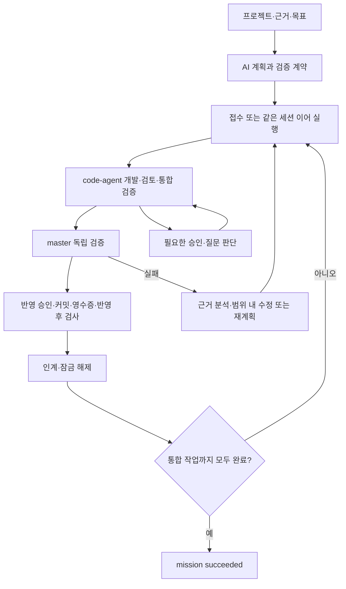

# master-agent

여러 프로젝트의 code-agent를 연결해 목표를 분석하고 작업을 배정·검증·인계하는 CLI 오케스트레이터다. LangGraph JS가 실행 흐름을 제어하고 SQLite에 판단·증거·체크포인트를 저장한다. 대시보드는 프로젝트·서비스 그룹·요청·공통 질문과 승인·단계별 이력·일괄 업데이트를 제공한다. 실제 모델과 자동 회귀의 검증 결과는 [검증 기록](docs/verification.md)을 따른다.

## 실행 프로세스



master는 목표·범위·의존성·독립 검증과 전체 완료를 관리한다. code-agent는 프로젝트 안의 개발 절차·승인 조건·호스트 실행을 관리한다. 독립 프로젝트의 개발은 병행할 수 있으며 같은 프로젝트의 잠금과 선행 작업 인계 조건을 유지한다.

완료는 모델의 문장이나 호스트 종료만으로 판정하지 않고 파일·검사·현재 트리·반영 계약을 대조한다. 로컬 완료가 원격 push·배포 완료를 뜻하지 않는다. 판단·사람 이관은 [위임 판단](docs/code-agent-control.md#위임-판단), 검증·문서 계약 인계는 [실제 검증](docs/live-verification.md), 실패·중단은 [복구](docs/recovery.md)와 [중단 처리](docs/interruption.md)를 따른다.

## 설치와 빠른 확인

Node.js **24.19 이상 24.x**와 Git이 필요하다. 실제 개발에는 빌드된 code-agent와 선택한 host의 CLI(Claude·Codex 또는 둘 다)가 필요하다. 소스 저장소에서 의존성을 설치한 뒤 로컬 패키지를 전역 명령으로 등록한다.

```powershell
cd C:\workspace\master-agent
npm.cmd ci --ignore-scripts
npm.cmd install -g --ignore-scripts .
master-agent help
```

`--ignore-scripts`는 의존성의 설치 스크립트를 생략한다. 공식 체크포인터의 전이 의존성인 `better-sqlite3`는 원래 네이티브 설치를 시도하지만 master-agent는 `node:sqlite` 어댑터를 사용한다. `overrides`로 해당 의존성을 설치 스크립트가 없는 로컬 스텁에 연결하므로 플래그 없는 `npm ci`도 네이티브 빌드 없이 설치된다. 스텁은 체크포인터 import만 지원하며 직접 DB 생성은 거부한다. 일반 설치와 CI에는 기존 `--ignore-scripts` 명령을 유지한다.

개발 중에는 전역 설치 대신 `npm.cmd link --ignore-scripts`를 사용할 수 있다. Windows 실행 정책이 `.ps1`을 막으면 `master-agent.cmd`를 사용한다. 명령을 찾지 못하면 `npm.cmd prefix -g`가 PATH에 있는지 확인한다. 제거는 `npm.cmd uninstall -g master-agent`로 한다. 대상 프로젝트의 code-agent 설치·초기화는 별도로 수행한다.

기본 DB는 **명령을 실행한 디렉터리의 `.master-agent/master.db`**다. 여러 터미널과 대시보드는 같은 작업 디렉터리 또는 동일한 절대 `--db` 경로를 사용한다. 설치 폴더에서 실행할 필요는 없다.

```powershell
master-agent demo --db .master-agent/demo.db
master-agent mission list --db .master-agent/demo.db
```

데모는 세 프로젝트의 고정 계획을 모의 실행해 `simulation-complete`로 끝난다. 실제 프로젝트 개발 완료와 구분한다. 설치·진단·배포 기능의 제공 범위는 [구현 현황](docs/implementation.md)을 따른다.

## 개발 검사와 선택 실행

기본 검사는 `npm.cmd run check`, `npm.cmd run lint`, `npm.cmd test`로 실행한다. check는 구문·문서 링크와 앵커를, lint는 미사용 변수·import와 미정의 이름을 검사한다. 테스트 파일은 프로세스·파일 경합을 줄이기 위해 최대 4개씩 실행한다. CI는 Windows·Ubuntu의 Node 24.x에서 `npm ci --ignore-scripts` 후 같은 검사를 실행한다. 외부 code-agent 빌드가 필요한 계약 시험은 빌드가 없는 환경에서 건너뛴다.

다음 smoke는 CI에서 실행하지 않으며 묶음 안의 스크립트를 순차 실행한다. `-- --list`는 실행 목록만 조회한다.

| 명령 | 실행 전제와 범위 |
| --- | --- |
| `npm.cmd run smoke:browser` | Chrome이 필요하며 `CHROME_PATH`로 지정한다. Windows 기본 위치는 `C:/Program Files/Google/Chrome/Application/chrome.exe`다. `smoke-dashboard-*.mjs`를 실행하며 업데이트·PC 신뢰 시험에는 code-agent 빌드와 Git·npm도 필요하다. |
| `npm.cmd run smoke:code-agent` | code-agent CLI를 자동 탐색하거나 `CODE_AGENT_CLI`로 지정한다. 상태·요청함 전송·지원 계약을 검사한다. 요청함 시험에는 Chrome과 테스트 대역을 포함한 code-agent 공개 빌드가 필요하다. |
| `npm.cmd run smoke:model` | `CLAUDE_CLI`와 code-agent 빌드가 필요하다. 전체 흐름 준비→실행→보고, 답변 문맥, 계획 분석을 검사하며 실제 모델 사용료가 발생한다. 전체 흐름 보고가 실패하면 다음 시험을 실행하지 않는다. |

라이선스는 미정이므로 `UNLICENSED`로 표시하고 저장소 URL은 확정 후 등록한다.

## 전체 현황 대시보드

실행·재시작·상태 확인·종료와 옵션은 [실행과 연결](docs/ui.md#실행과-연결)을 따른다. 같은 DB의 등록 프로젝트 전체를 관측하며 master 목표가 없는 독립 code-agent 작업도 포함한다. 화면에서 프로젝트·그룹·요청·작업 단계·질문·승인·이력을 확인한다.

- 등록·편집·삭제는 [프로젝트와 서비스 그룹](docs/ui.md#프로젝트와-서비스-그룹)을 따른다.
- 관측과 타임라인의 표시·수집 범위는 [요청과 진행 관제](docs/ui.md#요청과-진행-관제)를 따른다.
- 설치·프로젝트별 적용 확인과 중단 점검은 [code-agent 일괄 업데이트](docs/ui.md#code-agent-일괄-업데이트)를 따른다.

## 서비스 그룹과 유지보수 요청

프로젝트를 등록한 뒤 그룹 또는 단일 프로젝트에 요청한다. 아래 `order-api`는 등록된 프로젝트 ID이며 별도 DB를 쓰면 모든 명령에 같은 `--db <절대경로>`를 붙인다.

```powershell
master-agent group create commerce "커머스 서비스" --description "주문·결제 유지보수"
master-agent group add commerce order-api --revision 1
master-agent group request commerce "주문 취소 오류 수정" --task-number UZRF-392 --criterion "취소 회귀 테스트 통과"
master-agent project request order-api "조회 오류 수정" --host both --main codex --criterion "조회 회귀 통과"
master-agent request list
master-agent request show <요청ID>
master-agent request run <요청ID>
master-agent request continue <요청ID> --revision <요청버전>
```

요청 ID는 목표 ID다. 별도 실행기가 준비 점검·계획·개발·검증·인계를 진행하므로 대시보드를 닫아도 계속된다. `request run`은 접수 대기 또는 만료된 실행 임대의 기존 요청을 현재 터미널에서 실행한다. 설정·응답 보완 뒤에는 `request continue`로 같은 목표를 이어간다. 세부 조건과 입력 JSON은 [요청 사용법](docs/usage.md#서비스-그룹과-단일-프로젝트-요청)을 따른다.

TASK 번호는 [사용법](docs/usage.md#task-번호), host 선택은 [판단 규칙](docs/ai-planning.md#요청-host와-교차-검증)과 [개발 실행 규칙](docs/code-agent-control.md#역할과-적용-조건), 근거 수집은 [AI 계획](docs/ai-planning.md#근거-수집)을 따른다. 독립 검증은 [검증 계약·템플릿](docs/live-verification.md)을 준비한다.

## 실제 실행과 조회

직접 만든 live 목표는 [사용법](docs/usage.md)에 따라 프로젝트·근거·연결·계획·검증 계약을 준비한 뒤 실행한다.

```powershell
master-agent mission drive <목표ID> --control --provider claude
master-agent mission progress <목표ID>
master-agent mission show <목표ID>
master-agent mission escalations <목표ID>
master-agent mission graph <목표ID>
```

`progress`는 마지막 저장 관측에서 실행·승인 처리·사람 응답·장애를 구분한다. 작업별 상태와 `counts`를 함께 확인한다. 재부착·정지·사람 답 전달은 [통신 계약](docs/code-agent-control.md)을 따른다.

잘못 접수한 목표는 `mission cancel <목표ID> --revision <버전> [--reason <사유>]`로 취소한다. 실행 중 시도는 먼저 종료하며 상세 조건은 [사용법](docs/usage.md#일시-정지와-재개)을 따른다. 재계획 인계 뒤 트리 변경은 `mission replan-refresh`와 [재동기화 절차](docs/replanning.md)를 사용한다. 임대 회수·운영자 리셋은 [복구](docs/recovery.md), 체크포인트·이벤트 정리는 [기록 보존](docs/langgraph.md#기록-보존과-정리)을 따른다.

## code-agent 제어 연결

PC 신뢰·프로젝트 페어링·기존 터미널 연결은 [제어 연결(페어링)](docs/code-agent-control.md#제어-연결페어링), 연결 상태 배지는 [프로젝트 연결 상태](docs/ui.md#프로젝트-연결-상태)를 따른다.

## 공통 질문·승인 요청함

질문·승인·보류·응답 이력의 조작은 [공통 요청함 화면](docs/ui.md#공통-요청함), 지원 범위·전송·적용·재개 규칙은 [공통 요청함 계약](docs/dashboard-interactions.md)을 따른다.

## 현재 경계와 문서

후속 기능과 미검증 범위의 정본은 [남은 작업](docs/implementation.md#남은-작업), 수행한 시험의 결과와 재현 방법은 [검증 기록](docs/verification.md)을 따른다.

| 문서 | 내용 |
| --- | --- |
| [구현 현황과 다음 작업](docs/implementation.md) | 현재 기능·보완 우선순위 |
| [검증 기록](docs/verification.md) | 최신 결과·재현 방법·증거 |
| [CLI 사용법](docs/usage.md) | 등록·목표·실행·조회 명령·환경 변수 |
| [LangGraph 구조](docs/langgraph.md) | 그래프·SQLite·재시작·기록 보존 |
| [AI 계획](docs/ai-planning.md) | 근거 수집·계획·교차 검증 |
| [실제 검증](docs/live-verification.md) | 검증 계약·템플릿·인계 |
| [자동 진행](docs/autonomous-progress.md) | 작업별 보류·승인 후 재개 |
| [code-agent 통신 계약](docs/code-agent-control.md) | 연결·위임·이벤트·재부착·정지·제어권 인계 |
| [복구](docs/recovery.md) / [재계획](docs/replanning.md) / [반영 대조](docs/delivery-reconciliation.md) / [중단 처리](docs/interruption.md) | 실패·중단별 처리 |
| [로컬 대시보드](docs/ui.md) | 실행·등록·그룹·요청·관측·HTTP 계약 |
| [공통 요청함](docs/dashboard-interactions.md) | 지원·사람 채널·응답 보존·재현 |
| [요구사항](docs/requirements.md) / [설계](docs/architecture.md) / [오케스트레이션](docs/orchestration.md) | 설계 문서(현 구현과 다를 수 있음) |
