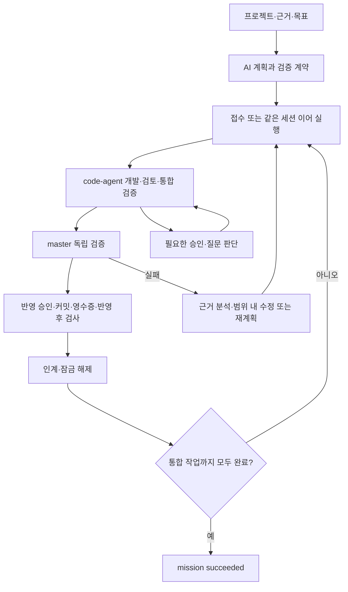

# master-agent

여러 프로젝트의 code-agent를 연결해 목표를 분석하고, 작업을 배정·검증·인계하는 CLI 오케스트레이터입니다. LangGraph JS가 실행 흐름을 제어하고 SQLite에 판단·증거·체크포인트를 저장합니다.

2026-10-17 기준 **실제 Claude로 두 프로젝트의 병렬 개발·계약 인계·통합 작업까지 완료**했습니다. 세 작업 모두 succeeded이며, 후속 계획 담당 배정 7건에서 두 선행 계약의 사본과 입력 해시를 대조했습니다. 위임 승인 9건, master 검사 8개는 반영 전후 통과했고 질문·사람 이관은 0건입니다. 최종 자동 회귀는 167개입니다. [검증 결과와 한계](docs/verification.md)를 참고하세요.

## 실행 프로세스

| 단계 | master-agent | code-agent |
| --- | --- | --- |
| 1. 프로젝트 준비 | 프로젝트·도메인·정책 근거 등록, 제어자 연결 | 설정·검증 명령·계약 문서 출력 위치 준비, 사용자가 연동과 위임 권한 부여 |
| 2. 목표·계획 | 목표·완료 조건·허용 범위를 받아 AI 계획 생성 및 근거·의존성 검사 | 기존 작업·상태·소유권 제공 |
| 3. 검증 계약 | 허용 파일·독립 검사·산출물·반영 조건 및 함수·입력·오류 계약(`exports`) 등록 또는 템플릿 연결 | 프로젝트 자체 검사 설정 유지 |
| 4. 개발 | 판단·잠금 저장 → 독립 프로젝트 접수 → 실행별 결과 조회·같은 세션 이어 실행 | 요구 확정 → 분석 → 영향 조사 → 설계 → 계획·검토 → 구현 → 테스트 → 리뷰 → 깨끗한 작업 트리 통합 검증 |
| 5. 판단·반영 | 권한 범위의 routine 승인·답변, 반영 전 독립 검사, 반영 커밋·영수증과 반영 후 검사 대조 | 권한·동의 내용·상태를 검증하고 승인 적용 및 로컬 반영 |
| 6. 인계·통합 완료 | 소스·계약 문서·검사·커밋 대조 → 잠금 해제·`inputContracts` 전달 → 통합 조건 대조 후 `succeeded` | 후속 작업의 첫 담당 배정 전에 `planning contracts`로 근거 등록 → 담당 입력·입력 해시에 연결 |



- **판단:** routine만 부여된 권한 안에서 처리합니다. ambiguous는 재검토 또는 추가 정보 요청, critical은 사람 판단으로 넘깁니다. 판단과 근거를 적용 전에 저장합니다.
- **완료:** 모델의 완료 메시지나 호스트 종료만으로 성공 처리하지 않습니다. 파일 범위·검사 결과·현재 트리·반영 계약을 대조합니다. 로컬 완료가 원격 push·배포 완료를 뜻하지는 않습니다.
- **실패·중단:** 확인된 실패는 범위 내 복구·재계획으로 연결합니다. 실행 여부가 불명확하면 `unknown`으로 보존하고 중복 제출하지 않습니다. 재시작 시 같은 실행에 재부착합니다.
- **실행 순서:** `drive --control`은 독립 프로젝트를 먼저 접수하고 실행 결과를 차례로 조회합니다. 외부 개발 실행은 겹칠 수 있고, 도메인 기록·판단·검사는 순차 처리합니다. 동일 프로젝트 잠금과 선행 작업 인계 조건은 유지합니다. 직접 Claude 실행과 개별 `dispatch/continue/reattach` 명령은 종료를 기다립니다.
- **진행 표시:** 저장된 `state`는 기존 제어 규칙을 유지합니다. `mission progress` 또는 `mission show`의 `progress`에서 실행 중, 승인 처리 대기·처리 중, 사람 답 필요, 실제 장애를 구분합니다.
- **계약 등록:** `exports[].documentPath`가 있으면 커밋된 문서의 원문·해시를 code-agent가 다시 검증해 세부 담당에게 전달합니다. 해당 문서는 작업 범위와 code-agent의 단계 출력 위치에 미리 포함해야 합니다. 계약 등록 명령을 지원하는 code-agent 빌드가 필요합니다.

## 설치와 빠른 확인

Node.js **24.19 이상 24.x**와 Git이 필요합니다. 실제 개발에는 빌드된 code-agent와 인증된 Claude CLI가 추가로 필요합니다. 계획·판단 provider는 Codex·Claude CLI 어댑터를 제공하며, 이번 실제 모델 검증은 Claude로 수행했습니다.

```powershell
npm.cmd ci --ignore-scripts
npm.cmd test
npm.cmd run check
npm.cmd run demo
node apps/cli/main.mjs help
```

데모는 세 프로젝트의 고정 계획을 모의 실행하고 `simulation-complete`로 끝납니다. 데이터는 기본 `.master-agent/master.db`에 저장하며 `--db <파일>`로 분리할 수 있습니다.

## 실제 실행과 조회

먼저 [사용법](docs/usage.md)에 따라 프로젝트를 등록하고 근거를 수집합니다. 각 프로젝트에서 사용자가 code-agent 연동과 grant를 설정한 뒤 `project control`로 연결합니다. `mode: live` 목표를 접수하고 계획 및 검증 계약을 준비합니다. 명령·JSON 형식은 [AI 계획](docs/ai-planning.md), [검증 계약](docs/live-verification.md), [통신 계약](docs/code-agent-control.md)을 따릅니다.

```powershell
# 연결·목표·검증 계약을 준비한 뒤 실제 실행
node apps/cli/main.mjs mission drive <목표ID> --cli <code-agent-CLI-절대경로> --control --provider claude

# 다른 터미널에서 진행·판단·체크포인트 조회
node apps/cli/main.mjs mission progress <목표ID>
node apps/cli/main.mjs mission show <목표ID>
node apps/cli/main.mjs mission escalations <목표ID>
node apps/cli/main.mjs mission graph <목표ID>
```

`mission pause`는 새 배정을 멈춥니다. 이미 실행 중인 호스트의 정지는 `mission stop <목표ID> <시도ID> --cli <경로> --mode pause`를 사용합니다. 재개·정지·사람 답 전달 조건은 [통신 계약](docs/code-agent-control.md)에 있습니다.

`progress.tasks`에는 `status`, `phase`, `reason`, `runId`, `lastProgressAt`, `nextAction`이 있습니다. `approval-pending`은 위임 판단 전, `approval-processing`은 판단·전송 중, `human-input`은 사람 응답 필요, `blocked`는 실패·미확인 등 점검 필요 상태입니다. 여러 작업이 병행되므로 목표의 요약 상태와 함께 `counts`와 작업별 상태를 확인하세요. 이 조회는 마지막 저장 관측을 표시하며 원격 조회를 새로 수행하지 않습니다.

두 격리 프로젝트의 실제 전체 흐름은 `scripts/smoke-full-flow.mjs`, 앞선 답의 판단 회귀는 `scripts/smoke-answer-context.mjs`로 재현합니다. 실제 모델 호출과 임시 Git 커밋을 수행하므로 일반 `npm test`에 포함하지 않습니다. 로컬 CLI 경로와 실행 방법은 [검증 기록](docs/verification.md)에 정리했습니다.

## 현재 경계와 문서

UI·HTTP 서버·원격 러너·운영 예산·Codex 개발 호스트는 후속 범위입니다. 실제 업무 규모의 품질, 자유 목표부터 전체 완료까지의 연속 시험, 실패 복구·프로세스 중단을 포함한 실제 모델 평가는 더 필요합니다.

| 문서 | 내용 |
| --- | --- |
| [구현 현황과 다음 작업](docs/implementation.md) | 두 저장소별 보완 우선순위, code-agent 담당 Codex 전달 지시 |
| [검증 기록](docs/verification.md) | 최신 결과·재현 방법·증거·미검증 범위 |
| [CLI 사용법](docs/usage.md) | 등록·목표·실행·조회 명령 |
| [LangGraph 구조](docs/langgraph.md) | 그래프·SQLite·재시작 규칙 |
| [code-agent 통신 계약](docs/code-agent-control.md) | 위임 판단·이벤트·재부착·정지·제어권 인계 |
| [복구](docs/recovery.md) / [재계획](docs/replanning.md) / [반영 대조](docs/delivery-reconciliation.md) / [중단 처리](docs/interruption.md) | 실패·중단별 처리 경계 |
| [요구사항](docs/requirements.md) / [설계](docs/architecture.md) / [오케스트레이션](docs/orchestration.md) / [UI 구상](docs/ui.md) | 제품 목표와 미구현 제안 |
